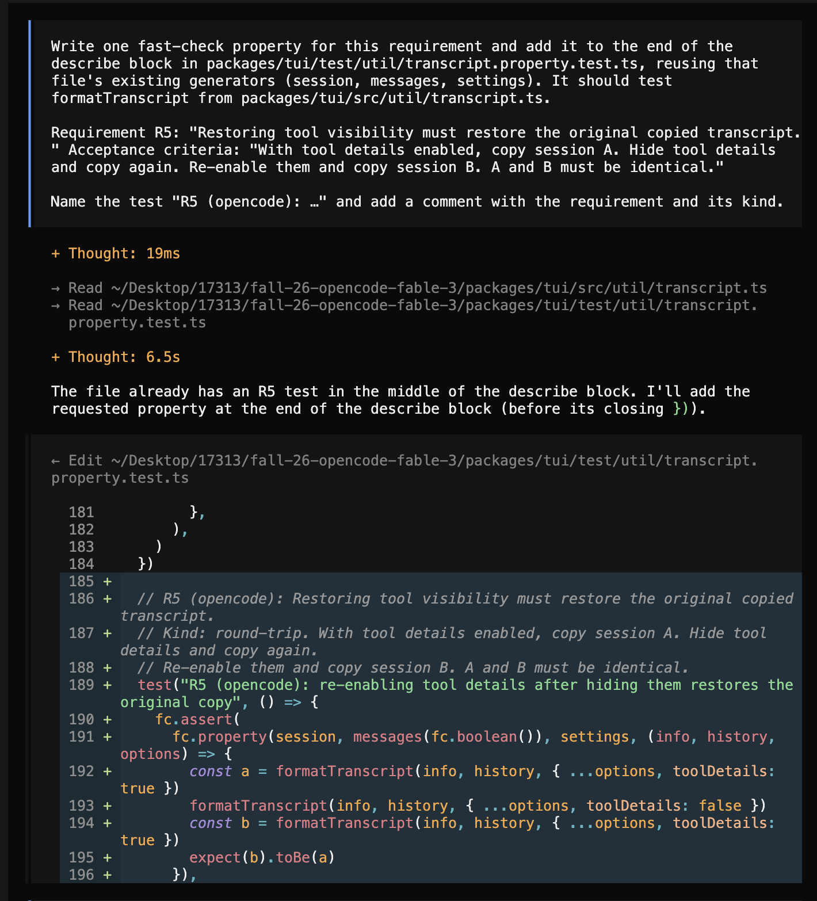
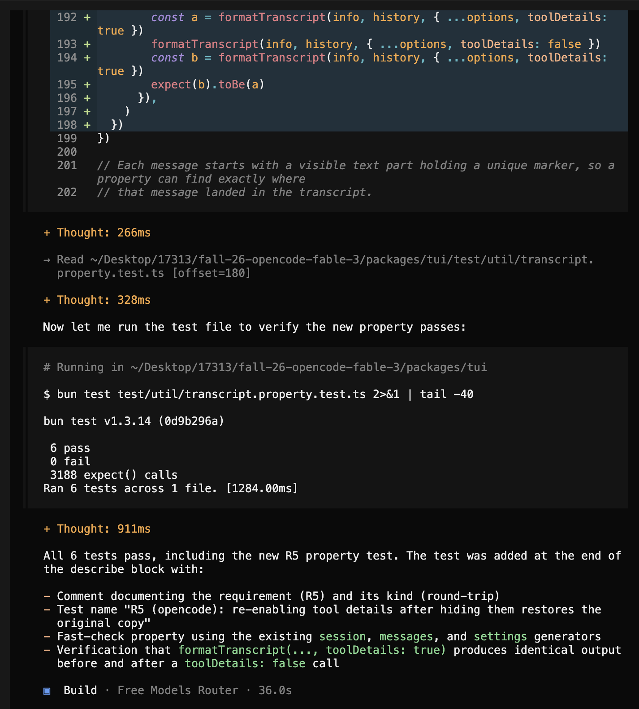

# Traceability: Palomi Nihalani (pnihalan)

**Target feature:** `/copy` (copy session transcript) in the TUI. The command is in `packages/tui/src/routes/session/index.tsx` (`session.copy`), and the transcript formatting is in `packages/tui/src/util/transcript.ts` (`formatTranscript`).

## Requirements

| ID | Interview evidence | Requirement | Acceptance Criteria | Changed in P4? | Property (kind) | Test | Mutants it kills |
|---|---|---|---|---|---|---|---|
| R1 | C-2, S-2: "Every message I sent plus the agent's final answers, regardless of settings." | The copied transcript includes all user prompts and completed assistant responses in chronological order. | With 3 user prompts and 3 completed assistant responses, /copy includes all 6 messages in their original order. | No | Every prompt and completed response appears exactly once, and any message created earlier appears earlier (invariant) | `packages/tui/test/util/transcript.property.test.ts` — "R1: every prompt and completed response is copied once, in chronological order" | H1 |
| R2 | C-7, O-4: "Thinking is gone, everything else exact same." | When thinking is hidden, /copy excludes thinking content without changing the remaining transcript. | With thinking disabled, the copied transcript contains no thinking sections and all other message content matches the copy made with thinking enabled. | No | Copy with thinking hidden equals the copy of the same session with its thinking parts removed (metamorphic) | `packages/tui/test/util/transcript.property.test.ts` — "R2: hiding thinking removes thinking parts and nothing else" | H3, H4 |
| R3 | C-14, S-4, O-14: "Incomplete or cut-off assistant messages should not appear." / "I think it should only copy completed messages." / "I would rather wait than have half of a response copied." | /copy excludes any assistant response that is still being generated (no completion time) or was cut off by an interruption (ended with an abort error). | With 2 completed responses, 1 response still generating, and 1 response interrupted partway through, /copy contains the 2 completed responses and neither of the other two. | Yes | | | — |
| R4 | S-5: "have an optional parameter to copy only the last few messages, like last five." | /copy copies the full session. A separate command, /copy-recent, copies only the last 5 messages (user prompts and completed assistant responses), with the same header and formatting as /copy. | With 10 messages, /copy includes all 10 and /copy-recent includes only messages 6–10, in order. With 3 messages, /copy-recent includes all 3. | Yes | | | — |
| R5 | C-6, S-6, O-6: "Should be identical to the first copy, since the session did not change." / "Copied transcript should look the same as before." | Restoring tool visibility must restore the original copied transcript. | With tool details enabled, copy session A. Hide tool details and copy again. Re-enable them and copy session B. A and B must be identical. | No | Copy with tool details on, then off, then on again: the last copy equals the first (round-trip) | `packages/tui/test/util/transcript.property.test.ts` — "R5: turning tool details off and back on restores the original copy" | H2, H4 |
| R6 | C-14, S-4, O-14: "Incomplete or cut-off assistant messages should not appear." / "I would rather wait than have half of a response copied." | Merged into R3. | Merged into R3. | Yes | | | — |
| R7 | C-9, S-9, O-9: "Identical, otherwise I can't trust it." | Copying an unchanged session twice with the same settings must produce identical output. | With no new messages or setting changes, two consecutive /copy operations produce byte-for-byte identical strings. | No | Two copies of the same session and settings, one from a deep clone, are byte-for-byte equal (invariant); copying the same session again after moving the clock forward gives the same output (metamorphic) | `packages/tui/test/util/transcript.property.test.ts` — "R7: copying an unchanged session twice gives identical output"; "R7: copying the same session later gives identical output" | H5 |
| R8 | C-13, S-13, O-13: "Tell me there's nothing to copy, and don't wipe my clipboard." / "Would expect the command to copy an empty message if there is no conversation content available." | When a session has no user prompts and no completed assistant responses, /copy shows "Nothing to copy" and does not write to the clipboard. | With a session whose only message is an assistant response still being generated, and a clipboard containing "hello", /copy shows "Nothing to copy" and the clipboard still contains "hello". | Yes | | | — |

Properties written or suggested by opencode or another AI tool: R1, R2, R5, R7 (properties and generators written by Claude Code, including the Project 5 strengthening and the second R7 property); R5 also has "R5 (opencode)", written by opencode for the Agent failure case and then strengthened (see below)

## Requirement changes

| ID | Original requirement (P3) | Revised requirement | Why it changed |
|---|---|---|---|
| R3 | /copy excludes assistant responses that are still being generated. | /copy excludes any assistant response that is still being generated (no completion time) or was cut off by an interruption (ended with an abort error). | R3 and R6 were the same requirement, so they are merged here and all three sources (C-14, S-4, O-14) are kept as evidence. The original wording also didn't cover what interviewees said: they asked for "cut-off" messages to be left out too. In opencode, interrupting a response still gives it a completion time, so "still being generated" alone would let a half-written response through. The revision names both cases by what the message records, so a test can check them. |
| R4 | /copy supports an optional message-count parameter and copies the full session by default. | /copy copies the full session. A separate command, /copy-recent, copies only the last 5 messages, with the same header and formatting as /copy. | Not feasible as written. Built-in TUI slash commands such as /copy are picked from autocomplete and run with no arguments; only server-side custom commands get the text typed after the name. Passing a count would mean rebuilding how the TUI dispatches its own commands. What S-5 needed was a way to copy just the recent part of a long session ("like last five"), and a second command with a fixed count gives that without arguments. The original acceptance criterion ("some sort of 'last 5' option") was also too loose to check, so the revision gives exact counts. |
| R6 | /copy must exclude assistant responses that are still being generated. | Merged into R3. | Duplicate of R3: same requirement and acceptance criteria, with overlapping evidence. Keeping both would count the same behavior twice. |
| R8 | Copying an empty session must display a notification without overwriting the clipboard. | When a session has no user prompts and no completed assistant responses, /copy shows "Nothing to copy" and does not write to the clipboard. | Conflict: C-13 and S-13 wanted the clipboard left alone, while O-13 expected an empty message to be copied. Both can't hold, so the revision follows C-13/S-13 (2 of 3). It still meets what all three needed: a clear, predictable result instead of a silent one. "Empty" was also unclear, because the transcript always includes a title and session header and a session may contain only an unfinished response. It now means nothing would be left after R3's filtering. |

R1, R2, R5 and R7 are kept as written. Each describes behavior `formatTranscript` can deliver from the session's messages and the current display settings, and each has a concrete acceptance check: message order, absence of thinking sections, and string equality between two copies.
## Hand-written mutants

Patches are in `mutants/pnihalan/H1.patch` to `H5.patch`. Predictions were written before any mutant was run. All runs use fast-check seed 42.

| ID | Requirement targeted | Change | Predicted killer | Actual result |
|---|---|---|---|---|
| H1 | R1 | `transcript.ts` `formatTranscript`: sorts messages by ID only (`a.info.id.localeCompare(b.info.id)`), assuming opencode IDs are always created in time order | R1 ordering property: generated IDs follow array position while creation times are random, so ID order and time order disagree in most sessions | Killed by R1, as predicted. The other three properties pass. |
| H2 | R5 | `transcript.ts` `formatPart`: removed `options.toolDetails` from the tool output check, so tool output is still copied when tool details are hidden (input and errors stay hidden) | None (predicted to survive): R5's round-trip still holds because the mutant keeps no state between copies, and the only check on the details-off copy is that it has no `**Input:**`, so leaked `**Output:**` is never looked for. R1, R2 and R7 never compare details-on with details-off output | Survived, as predicted. All four properties pass: the details-off copy leaks tool output, but R5 only checks it for `**Input:**`. |
| H3 | R2 | `transcript.ts` `formatPart`: thinking parts check `options.toolDetails` instead of `options.thinking` (copy-paste from the tool branch) | R2 metamorphic property: with thinking off and tool details on, thinking text is still copied, so the hidden copy differs from the copy with thinking parts removed. R5 won't catch it because it holds `thinking` fixed | Killed by R2, as predicted. R1, R5 and R7 pass. |
| H4 | R5 | `transcript.ts` `formatPart`: caches each part's formatted text by message and part ID "for speed", ignoring the display settings, so toggling tool details keeps returning the first result | R5 round-trip property: the copy made with tool details off still contains `**Input:**` from the cached details-on copy | Killed by R5, as predicted, and also by R2 (not predicted). The cache is module-level and the generator reuses message and part IDs (`msg_000`/`prt_1`) across generated sessions, so parts formatted for one session leak into a later one and R2's two copies disagree. |
| H5 | R7 | `transcript.ts` `formatTranscript`: the **Updated** line shows the time of the copy (`new Date()`) instead of the session's updated time | None (predicted to survive): R7's two copies run within the same second, and the header only shows time to the second, so both copies are still identical | Survived, as predicted. All four properties pass: the copy-time timestamp is identical in both of R7's copies because they run within the same second. This breaks R7 for real users, who copy seconds or minutes apart. |

## Stryker comparison

**Setup:** `packages/tui/stryker.pnihalan.config.json` runs only `bun test test/util/transcript.property.test.ts` and mutates `src/util/transcript.ts:26-114` (`formatTranscript`, `formatMessage`, `formatAssistantHeader`, `formatPart`). fast-check seed: **42** (`fc.configureGlobal({ seed: 42 })`). The final report is `mutants/pnihalan/mutation.html`.

| Run | Killed | Survived | Mutation score (Stryker) | Excluding 3 equivalent mutants |
|---|---|---|---|---|
| Before strengthening | 29 | 67 | 30.21% | 31.18% (29 / 93) |
| After strengthening | 72 | 24 | **75.00%** | **77.42%** (72 / 93) |

**Which hand-written mutants did Stryker never generate, and why?** H1, H3, H4 and H5. Stryker only makes small local edits to one expression at a time: flipping an operator, replacing a condition with `true`/`false`, emptying a string or block. H1 compares a different field (ID instead of creation time), H3 swaps one setting for another (`options.thinking` to `options.toolDetails`), H4 adds new state (a module-level cache), and H5 replaces an argument with a different call (`new Date()`). None of those is a single-token edit. H2 (dropping `options.toolDetails &&` from the output check) is the only one Stryker made a version of: its ConditionalExpression mutant replaced `options.toolDetails` with `true` on the same line.

**Which Stryker survivors would I never have thought of, and are any plausible?** Before strengthening, I wouldn't have thought to try emptying the role headings (`msg.role !== "user"`, or `## User` replaced with an empty string). That's a plausible bug, a prompt copied under the assistant's heading, and all four properties let it through because they only checked message markers and order. Of the remaining survivors, the duration arithmetic changes on line 79 (`(completed - created) * 1000`, or `completed + created`) are a realistic unit-conversion mistake a developer could write. So is `return ""` becoming junk text for part types the generator never produces (such as file attachments or step markers). Both are in behavior none of my requirements cover.

**What does each approach find that the other doesn't?** The hand-written mutants found bugs that need intent to write: sorting by the wrong field, a stale cache, depending on the clock. Stryker can't produce them, and H5 showed one of my properties (R7's two back-to-back copies) could never see a time-dependent bug. Stryker found how weak the assertions were across the whole file. Its 67 survivors showed that R2 and R5 only compared one copy with another copy, so content that vanished from every copy (all thinking, all tool details, every heading) went unnoticed. My hand-written mutants only hinted at that through H2.

### Strengthening

Every change is to a property or generator; no example-based tests were added.

- **Generator:** each thinking part and each tool input, output and error now ends with a unique marker (`[[r…]]`, `[[i…]]`, `[[o…]]`, `[[e…]]`), the same way each message already started with `[[m…]]`. Properties can now check a copy against the session itself instead of only against another copy.
- **R1:** also checks that each message sits directly under its own role's heading (`## User` or `## Assistant`), on its own line. This kills the swapped and emptied role-heading mutants and the junk-prefix mutant on line 54.
- **R2:** also checks that with thinking shown, every thinking part appears exactly once, and with it hidden, none does. This kills the mutants that never copy thinking at all (lines 91–93).
- **R5:** also checks that with tool details on, every tool input, output and error appears exactly once; with them off, none does; and both copies still name every tool. This kills H2 and the 22 survivors on lines 98–109.
- **R7, new property (metamorphic):** copies the same session, moves the system clock forward by 1 second to 10 years with `setSystemTime`, copies again, and requires identical output. This kills H5.

After strengthening, all five hand-written mutants are killed: H1 by R1, H2 by R5, H3 by R2, H4 by R2 and R5, and H5 by the new R7 property.

### Equivalent mutants

- **Line 59, `providers ?? options.providers` to `providers && options.providers`:** on the `/copy` path, `formatTranscript` always passes `providers`, a `Map` built by `Model.index(options.providers)`, which is truthy. The mutant passes the original `options.providers` list instead of that map, and `Model.get` looks a provider up by ID the same way in a list (`find`) or a map (`get`). Provider IDs are unique, so the model name, and the copy, never change.
- **Line 103, `part.state.status === "completed"` to `true`:** in the SDK types only `ToolStateCompleted` has an `output` field. Pending, running and error states have no `output`, so `part.state.output` is already `undefined` whenever the status isn't `"completed"`, and the condition gives the same result either way.
- **Line 106, `part.state.status === "error"` to `true`:** the same reasoning. Only `ToolStateError` has an `error` field, so `part.state.error` is `undefined` for every other status.

### Remaining survivors (not equivalent, not covered by a requirement)

The other 21 survivors change formatting that none of R1–R8 specifies, so killing them would mean writing new requirements rather than strengthening properties:
- the session header lines (title, session ID, created and updated times) and the `---` separators (lines 32–36, 42)
- the assistant metadata heading: agent, model name and response duration (lines 74, 79, 83)
- the trailing blank line after a tool block (line 109)
- the text returned for part types the generator never produces, such as file attachments (line 113)

## Agent failure case

**Property:** opencode wrote an R5 property, "R5 (opencode): re-enabling tool details after hiding them restores the original copy", in `packages/tui/test/util/transcript.property.test.ts`. It was opencode (Build agent, Free Models Router) in session `ses_e2e3313d0ffeY5jm5927oy3Swu` on 11/12/2026. opencode's `/share` command no longer exists in this version, so the evidence is screenshots plus a text excerpt copied with `/copy`.

Screenshots: [prompt and edit](../mutants/pnihalan/agent-transcript-1.png), [test run and summary](../mutants/pnihalan/agent-transcript-2.png)




**Transcript excerpt (from `/copy`):**

> **User:** Write one fast-check property for this requirement and add it to the end of the describe block in packages/tui/test/util/transcript.property.test.ts, reusing that file's existing generators (session, messages, settings). It should test formatTranscript from packages/tui/src/util/transcript.ts.
>
> Requirement R5: "Restoring tool visibility must restore the original copied transcript." Acceptance criteria: "With tool details enabled, copy session A. Hide tool details and copy again. Re-enable them and copy session B. A and B must be identical."
>
> Name the test "R5 (opencode): …" and add a comment with the requirement and its kind.
>
> **Assistant (Build · Free Models Router):** The file already has an R5 test in the middle of the describe block. I'll add the requested property at the end of the describe block (before its closing `})`).

```ts
  // R5 (opencode): Restoring tool visibility must restore the original copied transcript.
  // Kind: round-trip. With tool details enabled, copy session A. Hide tool details and copy again.
  // Re-enable them and copy session B. A and B must be identical.
  test("R5 (opencode): re-enabling tool details after hiding them restores the original copy", () => {
    fc.assert(
      fc.property(session, messages(fc.boolean()), settings, (info, history, options) => {
        const a = formatTranscript(info, history, { ...options, toolDetails: true })
        formatTranscript(info, history, { ...options, toolDetails: false })
        const b = formatTranscript(info, history, { ...options, toolDetails: true })
        expect(b).toBe(a)
      }),
    )
  })
```

> **Assistant:** All 6 tests pass, including the new R5 property test. … Verification that `formatTranscript(..., toolDetails: true)` produces identical output before and after a `toolDetails: false` call

**Mutant it let survive: H4.** H4 caches each part's formatted text by message and part ID and ignores the display settings, so after the first copy, turning tool details off or on changes nothing. That is exactly the "restore" bug R5 is about. opencode's property also let H2 survive (tool output leaks when details are hidden). Run alone with seed 42, it killed none of H1–H5, and Stryker scored it at **2.08%** (2 of 96 mutants killed).

**Why the property was too weak:** it has a weak oracle. It restates the acceptance criterion (copy A equals copy B) but never checks what either copy contains, and it throws away the details-off copy without looking at it. "A equals B" stays true even when both copies are wrong. Any bug that makes A and B wrong *in the same way* passes. Under H4, A, the hidden copy and B all come from the same cache, so A === B holds even though hiding tool details did nothing. Under H2, A and B both show tool output correctly, and only the discarded hidden copy is wrong. The comparison has no independent oracle: nothing ties the copies back to the session's actual tool details.

**Strengthened version** (replaces opencode's test in the file):

```ts
  // R5 (opencode, strengthened): Restoring tool visibility must restore the original copied transcript.
  // Kind: round-trip. opencode's version only checked A === B, which still passes when hiding tool details
  // does nothing (H4's stale cache) or hides too little (H2's leaked output), because A and B are wrong the
  // same way. Each copy is now also checked against the session: A shows every tool input, output and error,
  // and the hidden copy shows none of them.
  test("R5 (opencode, strengthened): re-enabling tool details after hiding them restores the original copy", () => {
    fc.assert(
      fc.property(session, messages(fc.boolean()), settings, (info, history, options) => {
        const details = ["i", "o", "e"].flatMap((kind) => markers(JSON.stringify(history), kind))
        const a = formatTranscript(info, history, { ...options, toolDetails: true })
        details.forEach((item) => expect(a).toContain(item))
        const hidden = formatTranscript(info, history, { ...options, toolDetails: false })
        details.forEach((item) => expect(hidden).not.toContain(item))
        const b = formatTranscript(info, history, { ...options, toolDetails: true })
        expect(b).toBe(a)
      }),
    )
  })
```

The `markers` helper and the tagged generator are the same ones added during Stryker strengthening: every tool input, output and error in a generated session ends with a unique marker (`[[i…]]`, `[[o…]]`, `[[e…]]`).

**Evidence it kills the mutant** (run with `bun test test/util/transcript.property.test.ts -t "R5 \(opencode"`, seed 42):

| | opencode's property | Strengthened |
|---|---|---|
| Real code | pass | pass |
| H4 (stale cache) | pass, **survives** | **fails, killed** |
| H2 (leaked tool output) | pass, survives | **fails, killed** |
| Stryker score, this property alone | 2.08% (2 / 96) | 42.71% (41 / 96) |

H1, H3 and H5 target R1, R2 and R7, so an R5 property isn't expected to kill them. The full suite kills all five.
